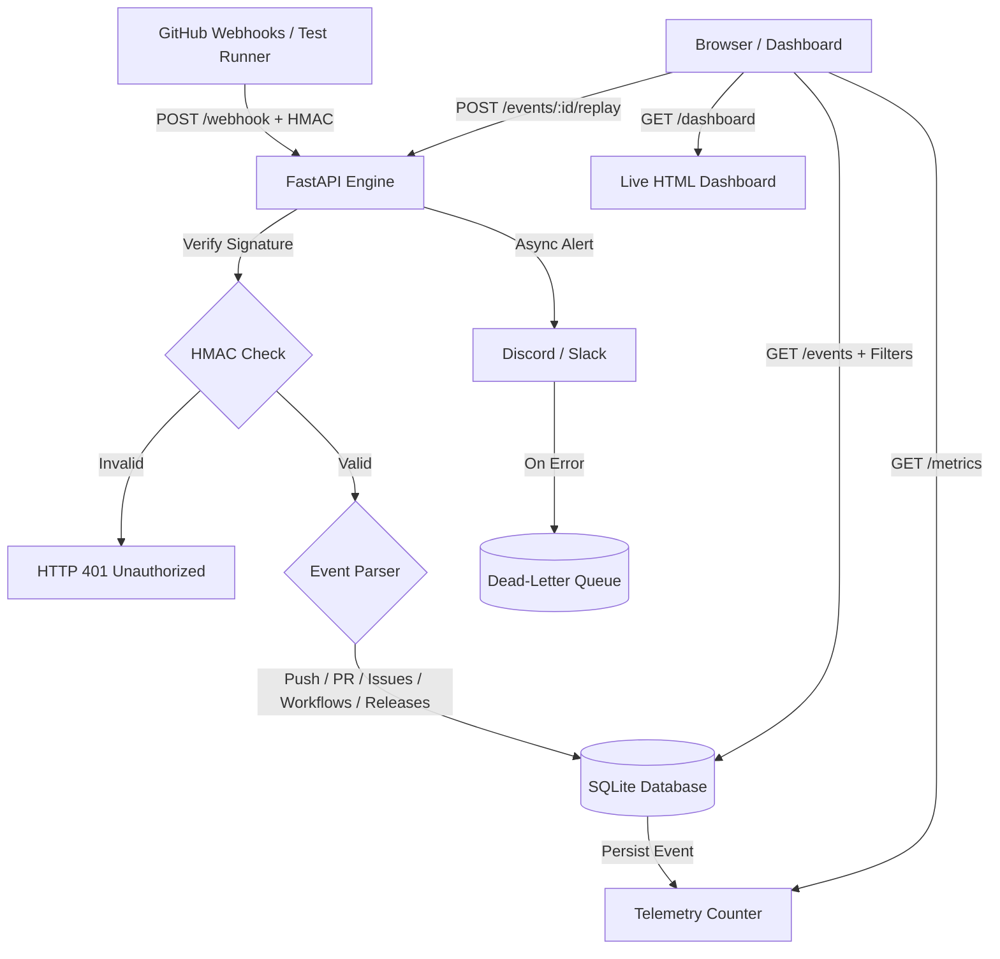

# GitPulse Engine


> A lightweight, event-driven GitHub telemetry receiver, metric aggregator, Dead-Letter Queue, and real-time dashboard built with FastAPI.

---

## Overview

**GitPulse Engine** ingests, validates, stores, and analyzes live GitHub Webhook events in real time. It acts as an automated telemetry pipeline to track repository activity—including commit volume, unique authors, pull requests, issue tracking, CI/CD workflow runs, and releases—with persistent SQLite storage, multi-channel alerts (Discord & Slack), Dead-Letter Queue (DLQ) support, and an interactive live web dashboard.

---

## Features

- **Multi-Event Webhook Ingestion**: Supports `push`, `pull_request`, `issues`, `workflow_run`, `release`, and `ping` GitHub events.
- **HMAC SHA-256 Signature Verification**: Cryptographically verifies incoming payloads via the `X-Hub-Signature-256` header with constant-time comparison.
- **SQLite Persistence Layer**: Persists full event histories and dynamically calculates telemetry metrics across service restarts.
- **Advanced Query & Filtering API**: Filter event history by `event_type`, `repository`, `sender`, date ranges (`since`/`until`), with full pagination (`limit`/`offset`).
- **Event Replay & Dead-Letter Queue (DLQ)**: Failed deliveries are captured in the DLQ, and any ingested event can be replayed on-demand via `POST /events/{id}/replay`.
- **Live Interactive Web Dashboard**: Dark-themed, zero-dependency browser dashboard (`GET /dashboard`) with live auto-refreshing telemetry cards, stream table, and one-click event replays.
- **Multi-Channel Alert Dispatcher**: Dispatches instant notifications to Discord and Slack webhooks with non-blocking error handling.
- **Mock CLI Test Runner**: Built-in test script with sample JSON payloads (`push`, `pull_request`, `issues`, `workflow_run`, `release`) for testing without internet-facing tunnels.

---

## Architecture Flow



---

## API Endpoints

| Method | Endpoint | Description |
|---|---|---|
| `GET` | `/dashboard` | Interactive real-time telemetry web dashboard UI |
| `GET` | `/` | Service info and endpoint index |
| `GET` | `/health` | Health status, system uptime, and database connectivity check |
| `GET` | `/metrics` | Telemetry aggregates (total events, pushes, PRs, issues, CI runs, releases, per-repo counts) |
| `GET` | `/analytics/leaderboard` | Top repositories and authors ranked by activity volume |
| `POST` | `/metrics/reset` | Resets metrics counters and clears SQLite event and DLQ history |
| `GET` | `/events` | Filtered & paginated event history (`event_type`, `repository`, `sender`, `since`, `until`, `limit`, `offset`) |
| `GET` | `/events/search` | Search event summaries, repositories, or authors by keyword (`?q=...`) |
| `GET` | `/events/export` | Export event history in CSV or JSON format (`?format=csv` or `?format=json`) |
| `GET` | `/events/{event_id}` | Detailed event record with parsed JSON payload |
| `POST` | `/events/{event_id}/replay` | Replay an existing event and re-trigger notifications |
| `GET` | `/dlq` | Inspect failed notification deliveries and Dead-Letter Queue entries |
| `POST` | `/dlq/clear` | Clear Dead-Letter Queue records |
| `POST` | `/webhook` | Ingestion listener for GitHub webhook payloads |


---

## Tech Stack

- **Backend**: Python 3.10+, FastAPI, Uvicorn, Starlette
- **Data & Storage**: SQLite 3, JSON
- **Security**: HMAC-SHA256 (`X-Hub-Signature-256`)
- **Integrations**: GitHub Webhooks, Discord Webhooks, Slack Incoming Webhooks

---

## Getting Started

### Prerequisites

- Python 3.10+
- Git
- `pip` package manager

### Installation

1. **Clone the repository:**
   ```bash
   git clone https://github.com/anikanandish/gitpulse-engine.git
   cd gitpulse-engine
   ```

2. **Create and activate a virtual environment:**
   ```bash
   # Windows (PowerShell)
   python -m venv venv
   .\venv\Scripts\Activate.ps1

   # Linux / macOS
   python3 -m venv venv
   source venv/bin/activate
   ```

3. **Install dependencies:**
   ```bash
   pip install -r requirements.txt
   ```

4. **Configure environment variables (optional):**
   Copy `.env.example` to `.env` and set desired secrets:
   ```bash
   # Windows
   copy .env.example .env

   # Linux / macOS
   cp .env.example .env
   ```

---

## Environment Variables

| Variable | Default | Description |
|---|---|---|
| `WEBHOOK_SECRET` | *(None)* | Secret token configured in GitHub Webhooks for HMAC-SHA256 validation |
| `GITPULSE_DB_FILE` | `gitpulse.db` | Path to SQLite database file |
| `DISCORD_WEBHOOK_URL` | *(None)* | Optional Discord channel webhook URL for telemetry alerts |
| `SLACK_WEBHOOK_URL` | *(None)* | Optional Slack incoming webhook URL for telemetry alerts |
| `MAX_PAYLOAD_SIZE` | `2097152` (2MB) | Maximum allowed webhook request payload size in bytes |

---

## Running the Engine

### Option A: Direct Local Execution
Start the Uvicorn server:
```bash
uvicorn gitpulse:app --reload --port 8000
```

### Option B: Docker Compose Containerization
Run GitPulse Engine inside an isolated container with persistent database volume:
```bash
docker compose up -d --build
```

Once running, access:
- **Web Dashboard**: [http://127.0.0.1:8000/dashboard](http://127.0.0.1:8000/dashboard)
- **API Root**: [http://127.0.0.1:8000/](http://127.0.0.1:8000/)
- **Health Check**: [http://127.0.0.1:8000/health](http://127.0.0.1:8000/health)
- **Interactive Swagger Docs**: [http://127.0.0.1:8000/docs](http://127.0.0.1:8000/docs)
- **Live Metrics**: [http://127.0.0.1:8000/metrics](http://127.0.0.1:8000/metrics)
- **Event History**: [http://127.0.0.1:8000/events](http://127.0.0.1:8000/events)
- **Export Data**: [http://127.0.0.1:8000/events/export?format=csv](http://127.0.0.1:8000/events/export?format=csv)
- **Dead-Letter Queue**: [http://127.0.0.1:8000/dlq](http://127.0.0.1:8000/dlq)


---

## Testing

### Automated Unit Test Suite
Run the test suite with Python's built-in `unittest`:
```bash
python -m unittest discover tests -p "test_*.py"
```

### Local Webhook Mock Runner
Simulate GitHub webhook events locally without an external tunnel:

```bash
# Push event
python test_webhook.py push

# Pull Request event
python test_webhook.py pull_request

# Issues event
python test_webhook.py issues

# CI Workflow Run event
python test_webhook.py workflow_run

# Release event
python test_webhook.py release
```

---

## Roadmap

- [x] In-memory telemetry counter & metrics endpoint
- [x] Local mock event test runner
- [x] HMAC SHA-256 signature verification for webhook payloads
- [x] SQLite persistence layer for event history
- [x] Discord / Slack notification dispatcher
- [x] Expanded event support (Issues, Workflows, Releases, Pings)
- [x] Advanced Event Querying & Pagination API
- [x] Webhook replay and Dead Letter Queue (DLQ)
- [x] Real-time web dashboard UI
- [x] Automated health check & system uptime tracking (`GET /health`)
- [x] Event history export in CSV and JSON formats (`GET /events/export`)
- [x] Ingestion security guards (payload size limits, delivery ID audit trail)
- [x] Docker & Docker Compose containerization
- [x] Activity leaderboard analytics API (`GET /analytics/leaderboard`)
- [x] Event keyword search across multiple fields (`GET /events/search`)
- [x] Dispatcher delivery retry mechanism with exponential backoff
- [x] Automated unit test suite & GitHub Actions CI pipeline
- [ ] Redis / Celery queue for distributed high-load processing


---

## License

This project is licensed under the MIT License.
