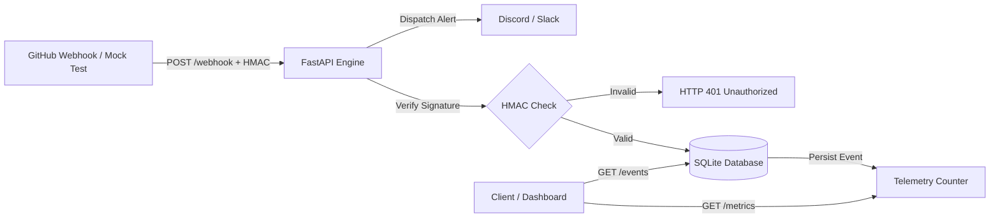

# GitPulse Engine


> A lightweight, event-driven GitHub telemetry receiver, metric aggregator, and multi-channel notification dispatcher built with FastAPI.

---

## Overview

**GitPulse Engine** ingests, validates, stores, and analyzes live GitHub Webhook events in real time. It acts as an automated telemetry pipeline to track repository activity—including commit volume, unique authors, pull request statuses, and multi-repository metrics—with SQLite persistence and optional alert dispatching to Discord and Slack.

---

## Features

- **Real-Time Webhook Processing**: Ingests asynchronous GitHub webhook payloads (`push`, `pull_request`, and workflow events).
- **HMAC SHA-256 Signature Verification**: Cryptographically verifies incoming payloads via the `X-Hub-Signature-256` header using constant-time comparison.
- **SQLite Persistence Layer**: Persists incoming events and restores telemetry metrics across service restarts.
- **Multi-Channel Alert Dispatcher**: Dispatches instant notifications to Discord and Slack webhooks with non-blocking fail-safes.
- **Live Metrics & History API**: Provides real-time event aggregation and queryable recent event history.
- **Local Test Runner**: Built-in CLI test script with mock fixtures for testing payloads without external tunnels.

---

## Architecture Flow



---

## API Endpoints

| Method | Endpoint | Description |
|---|---|---|
| `GET` | `/` | Health status, version, and route index |
| `GET` | `/metrics` | Telemetry aggregates (total events, pushes, PRs, per-repo counts) |
| `POST` | `/metrics/reset` | Resets in-memory metrics and clears SQLite event history |
| `GET` | `/events?limit=20` | Retrieves recent persisted webhook events |
| `POST` | `/webhook` | Ingestion listener for GitHub webhook payloads |

---

## Tech Stack

- **Backend**: Python 3.10+, FastAPI, Uvicorn, Starlette
- **Data & Storage**: SQLite 3, JSON
- **Security**: HMAC-SHA256 (`X-Hub-Signature-256`)
- **Integrations**: GitHub Webhooks, Discord Webhooks, Slack Incoming Webhooks

---

## Getting Started

### Prerequisites

- Python 3.10+
- Git
- `pip` package manager

### Installation

1. **Clone the repository:**
   ```bash
   git clone https://github.com/anikanandish/gitpulse-engine.git
   cd gitpulse-engine
   ```

2. **Create and activate a virtual environment:**
   ```bash
   # Windows (PowerShell)
   python -m venv venv
   .\venv\Scripts\Activate.ps1

   # Linux / macOS
   python3 -m venv venv
   source venv/bin/activate
   ```

3. **Install dependencies:**
   ```bash
   pip install -r requirements.txt
   ```

4. **Configure environment variables (optional):**
   Copy `.env.example` to `.env` and set desired secrets:
   ```bash
   # Windows
   copy .env.example .env

   # Linux / macOS
   cp .env.example .env
   ```

---

## Environment Variables

| Variable | Default | Description |
|---|---|---|
| `WEBHOOK_SECRET` | *(None)* | Secret token configured in GitHub Webhooks for HMAC-SHA256 validation |
| `GITPULSE_DB_FILE` | `gitpulse.db` | Path to SQLite database file |
| `DISCORD_WEBHOOK_URL` | *(None)* | Optional Discord channel webhook URL for telemetry alerts |
| `SLACK_WEBHOOK_URL` | *(None)* | Optional Slack incoming webhook URL for telemetry alerts |

---

## Running the Engine

Start the Uvicorn server:
```bash
uvicorn gitpulse:app --reload --port 8000
```

Once running, access:
- **API Root**: [http://127.0.0.1:8000/](http://127.0.0.1:8000/)
- **Interactive Swagger Docs**: [http://127.0.0.1:8000/docs](http://127.0.0.1:8000/docs)
- **Live Metrics**: [http://127.0.0.1:8000/metrics](http://127.0.0.1:8000/metrics)
- **Event History**: [http://127.0.0.1:8000/events](http://127.0.0.1:8000/events)

---

## Local Testing

Simulate GitHub webhook events locally without an external tunnel:

```bash
# Trigger a simulated push event
python test_webhook.py push

# Trigger a simulated pull request event
python test_webhook.py pull_request
```

---

## Roadmap

- [x] In-memory telemetry counter & metrics endpoint
- [x] Local mock event test runner
- [x] HMAC SHA-256 signature verification for webhook payloads
- [x] SQLite persistence layer for event history
- [x] Discord / Slack notification dispatcher
- [ ] Redis / Celery queue for distributed high-load processing
- [ ] Webhook replay and Dead Letter Queue (DLQ)
- [ ] Real-time web dashboard UI

---

## License

This project is licensed under the MIT License.
